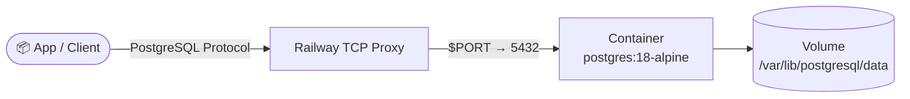

# PostgreSQL for railway.app


Deploy PostgreSQL 18 on Railway with the official Docker image. This template provisions a ready-to-run relational database for your application data, analytics, or as a shared backing store for other services in your project. It includes sensible defaults, a built-in health check, and guidance for attaching persistent storage so your data survives redeploys.

[](https://railway.com/deploy/postgresql-1?referralCode=2_sIT9&utm_medium=integration&utm_source=template&utm_campaign=generic)

## 🏗️ Architecture



## Environment

| Variable | Required | Description |
|----------|----------|-------------|
| `POSTGRES_PASSWORD` | Yes | Password for the `postgres` user |

## Optional

| Variable | Description |
|----------|-------------|
| `POSTGRES_USER` | Defaults to `postgres` |
| `POSTGRES_DB` | Defaults to `postgres` |
| `POSTGRES_INIT_DUMP_URL` | HTTPS URL to a `.sql` or gzip-compressed `.sql.gz` dump (e.g. `pg_dump --format=plain`); downloaded and imported automatically, but only on the first start of an empty volume. Takes precedence over `POSTGRES_INIT_DUMP_BASE64` if both are set. |
| `POSTGRES_INIT_DUMP_BASE64` | Same dump, base64-encoded and pasted directly as the variable value. Ignored if `POSTGRES_INIT_DUMP_URL` is also set. Best for small dumps only. |
| `POSTGRES_AUTO_UPGRADE` | Defaults to `true`. Upgrade an existing PostgreSQL 16 volume to 18 automatically on start. Set to `false` to keep running PostgreSQL 16 for now. |
| `POSTGRES_UPGRADE_MODE` | `copy` (default) or `link`. `link` uses hard links and needs almost no extra space, but there is no way back to 16 afterwards. |
| `POSTGRES_UPGRADE_DELETE_BACKUP` | Set to `true` and redeploy to delete `.pg16-backup` after a successful upgrade. |

> [!NOTE]
> `POSTGRES_INIT_DUMP_URL`/`POSTGRES_INIT_DUMP_BASE64` are only ever consulted on the very first start against a brand-new, empty volume. Once the database has initialized, both variables are silently ignored on every later restart or redeploy — even if you leave them set. The dump runs with full administrative privileges during bootstrap, so only point these at dumps from sources you trust.

## Persistence

`railway.toml` declares `requiredMountPath = "/var/lib/postgresql/data"`. Attach a Railway volume to that path before production traffic — Railway will prompt for it based on this setting, but it is not created automatically.

## Upgrading to PostgreSQL 18

Template versions before 0.3.0 ran PostgreSQL 16. PostgreSQL 18 cannot start a PostgreSQL 16 data directory directly, so the image ships the PostgreSQL 16 binaries and upgrades an existing volume in place with `pg_upgrade` on the first start:

1. PostgreSQL 16 is started once to finish crash recovery and to read the encoding, locale and checksum settings.
2. A new PostgreSQL 18 cluster is created with the same settings in `/var/lib/postgresql/data/.pg18-upgrade` and filled with `pg_upgrade --copy`. Users, passwords, databases, extensions, `pg_hba.conf` and `ALTER SYSTEM` settings are kept.
3. The new cluster is test-started. Only then are the directories switched. The original PostgreSQL 16 files stay in `/var/lib/postgresql/data/.pg16-backup`.

What to know before you update:

- **Back up first.** Take a `pg_dump` or a Railway volume backup before you deploy the new version.
- **Disk space.** The default copy mode needs about as much free space as the database already uses. If there is not enough space, the upgrade is skipped and PostgreSQL 16 keeps running. Grow the volume, or set `POSTGRES_UPGRADE_MODE=link`.
- **If the upgrade fails**, nothing is changed: the temporary cluster is removed and the service keeps running PostgreSQL 16 with a warning in the logs. To stay on 16 on purpose, set `POSTGRES_AUTO_UPGRADE=false`. This compatibility mode will be removed in a later release.
- **Rolling back.** Copy mode keeps the old files in `.pg16-backup`. To go back, move them back into place and deploy template version 0.2.x. Data written after the upgrade is not in the backup.
- **Free the space** after you have checked your data: set `POSTGRES_UPGRADE_DELETE_BACKUP=true` and redeploy once.
- **Data path.** The official PostgreSQL 18 image moved `PGDATA` to `/var/lib/postgresql/18/docker`. This template keeps `PGDATA=/var/lib/postgresql/data`, so the volume mount does not change.
- **New clusters** created by PostgreSQL 18 have data checksums enabled. Upgraded clusters keep their previous checksum setting.
- Only PostgreSQL 16 data can be upgraded automatically. Other versions stop with a clear error and no changes; use `pg_dump`/`pg_restore` for those.
- See the [PostgreSQL 17](https://www.postgresql.org/docs/release/17.0/) and [PostgreSQL 18](https://www.postgresql.org/docs/release/18.0/) release notes for incompatible changes that may affect your application.

## Local

```bash
docker build -t railwayapp-postgresql .
docker run --rm -e POSTGRES_PASSWORD=dev -p 5432:5432 railwayapp-postgresql
```

## 💬 Support

Questions or feedback? Visit the [template forum on Railway Central Station](https://station.railway.com/templates/postgre-sql-983bebe8).

<!-- footer -->
---

[](https://github.com/vergissberlin/railwayapp-airbyte) [](https://github.com/vergissberlin/railwayapp-airflow) [](https://github.com/vergissberlin/railwayapp-cloudbeaver-ce) [](https://github.com/vergissberlin/railwayapp-codimd) [](https://github.com/vergissberlin/railwayapp-django) [](https://github.com/vergissberlin/railwayapp-email) [](https://github.com/vergissberlin/railwayapp-fastapi) [](https://github.com/vergissberlin/railwayapp-flask) [](https://github.com/vergissberlin/railwayapp-flowise) [](https://github.com/vergissberlin/railwayapp-gitlab) [](https://github.com/vergissberlin/railwayapp-grafana) [](https://github.com/vergissberlin/railwayapp-homeassistant) [](https://github.com/vergissberlin/railwayapp-influxdb) [](https://github.com/vergissberlin/railwayapp-mjml) [](https://github.com/vergissberlin/railwayapp-mongodb) [](https://github.com/vergissberlin/railwayapp-mqtt) [](https://github.com/vergissberlin/railwayapp-mysql) [](https://github.com/vergissberlin/railwayapp-n8n) [](https://github.com/vergissberlin/railwayapp-nodejs) [](https://github.com/vergissberlin/railwayapp-nodered) [](https://github.com/vergissberlin/railwayapp-opensearch) [](https://github.com/vergissberlin/railwayapp-openwebui) [](https://github.com/vergissberlin/railwayapp-operately) [](https://github.com/vergissberlin/railwayapp-outerbase-studio) [](https://github.com/vergissberlin/railwayapp-postgresql) [](https://github.com/vergissberlin/railwayapp-redis) [](https://github.com/vergissberlin/railwayapp-typo3)
